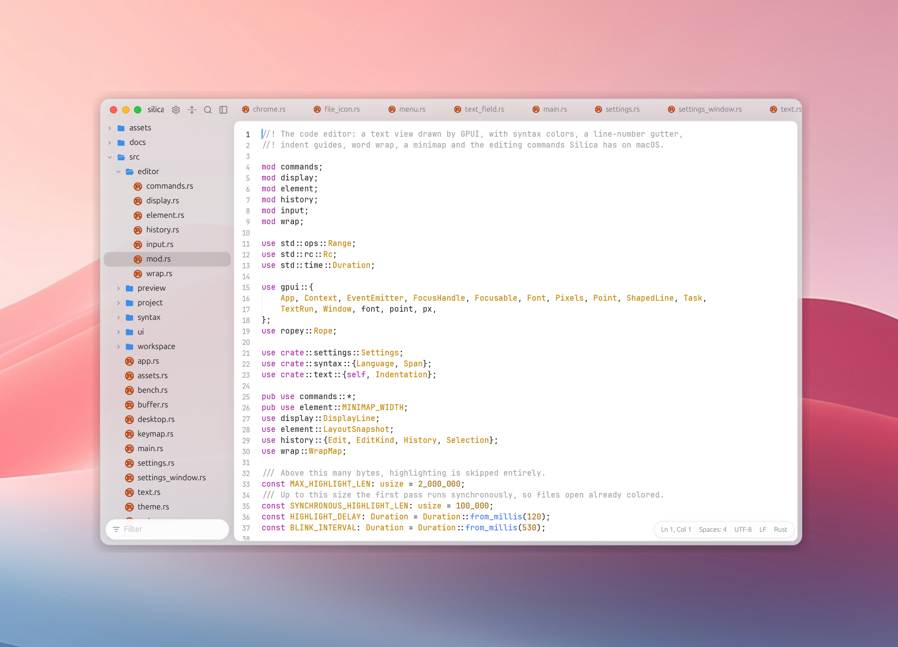

# Silica

A lightweight native code editor for Linux, built with Rust and [GPUI](https://www.gpui.rs/).



## Features

- GPU-rendered UI on Wayland and X11
- Syntax highlighting with 9 color themes
- Line numbers, indent guides, word wrap and minimap
- File explorer with live reload when files change on disk
- Quick Open (fuzzy file search, respects `.gitignore`)
- Regex search across the project
- Rendered preview for Markdown, CSV and HTML
- Restores open folders and tabs between sessions
- Follows the system light/dark mode and fonts

Supported languages: C, C++, C#, CSS, Diff, Dockerfile, Go, HTML, Java, JavaScript, JSON, Kotlin, Makefile, Markdown, Objective-C, PHP, Python, Ruby, Rust, Shell, SQL, Swift, TOML, TypeScript, XML, YAML.

## Requirements

- Rust 1.85 or newer
- A GPU with Vulkan support
- Build dependencies (Debian/Ubuntu):

  ```sh
  sudo apt install build-essential pkg-config libxcb1-dev libxkbcommon-dev libxkbcommon-x11-dev
  ```

## Installation

```sh
git clone https://github.com/nvtoan0201-swe/silica-linux.git
cd silica-linux
cargo install --path .
```

This installs the `silica-linux` binary to `~/.cargo/bin`.

## Usage

```sh
silica-linux                    # open the welcome screen
silica-linux path/to/project    # open a folder
silica-linux file.rs other.rs   # open files
```

## Keyboard shortcuts

| Action | Shortcut |
| --- | --- |
| Open | `Ctrl+O` |
| New file | `Ctrl+N` |
| Save / Save all | `Ctrl+S` / `Ctrl+Alt+S` |
| Close tab | `Ctrl+W` |
| Quick Open | `Ctrl+P` |
| Find in project | `Ctrl+Shift+F` |
| Go to line | `Ctrl+G` |
| Toggle comment | `Ctrl+/` |
| Move line up / down | `Alt+↑` / `Alt+↓` |
| Duplicate line up / down | `Alt+Shift+↑` / `Alt+Shift+↓` |
| Toggle word wrap | `Alt+Z` |
| Toggle preview | `Ctrl+Shift+V` |
| Toggle sidebar | `Ctrl+B` |
| Next / previous tab | `Ctrl+PgDn` / `Ctrl+PgUp` |
| Zoom in / out / reset | `Ctrl+=` / `Ctrl+-` / `Ctrl+0` |
| Settings | `Ctrl+,` |

## Configuration

Open the settings window with `Ctrl+,`. Settings are stored in `~/.config/silica/settings.json`:

```json
{
  "fontSize": 13.0,
  "fontFamily": "JetBrains Mono",
  "tabWidth": 4,
  "indentsWithTabs": false,
  "wrapsLines": true,
  "showsLineNumbers": true,
  "showsIndentGuides": true,
  "showsMinimap": false,
  "syntaxTheme": "one",
  "appearance": "system",
  "restoresTabs": true
}
```

| Key | Values |
| --- | --- |
| `syntaxTheme` | `one`, `github`, `xcode`, `solarized`, `catppuccin`, `gruvbox`, `tokyoNight`, `rosePine`, `dracula` |
| `appearance` | `system`, `light`, `dark` |
| `tabWidth` | `2`, `4`, `8` |
